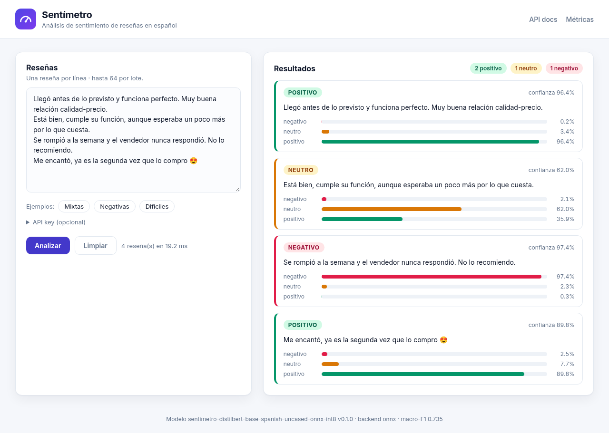
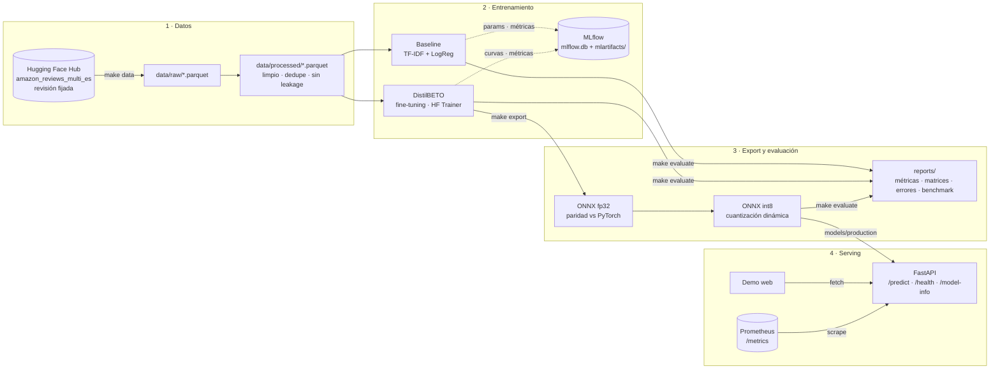
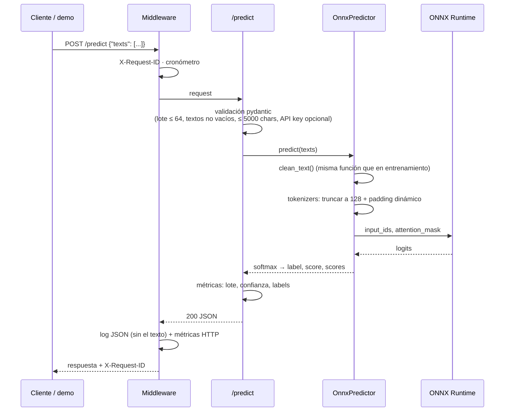
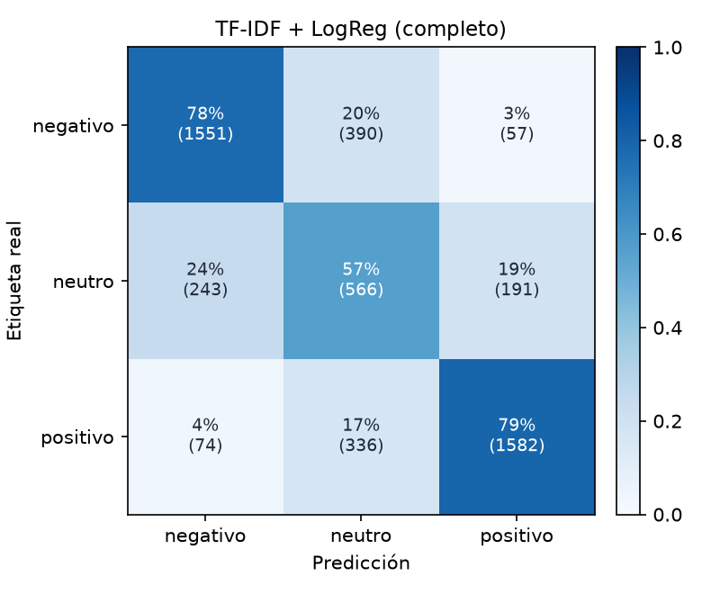
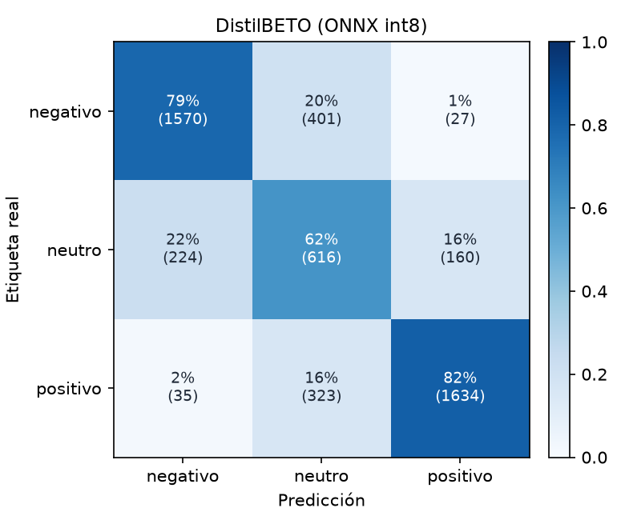
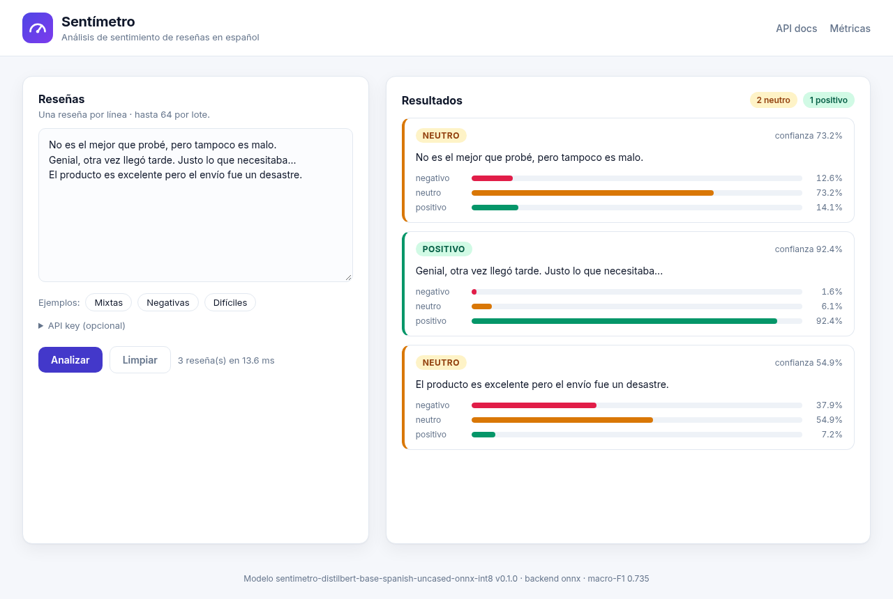
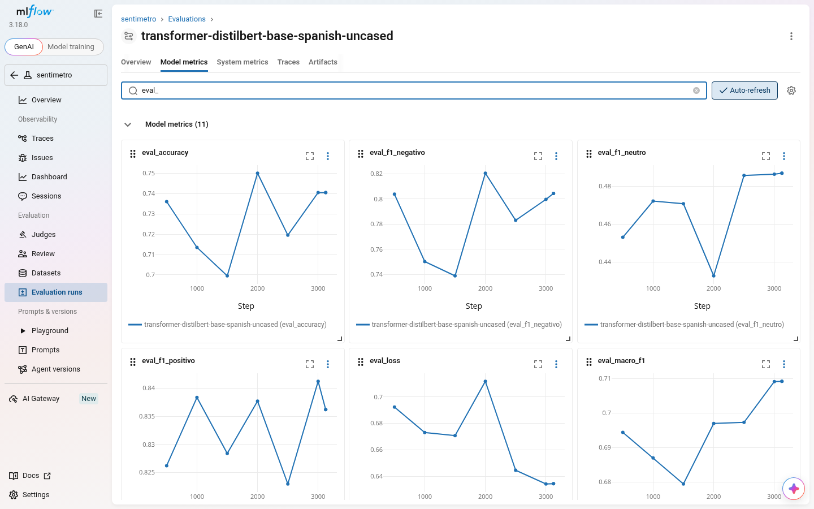
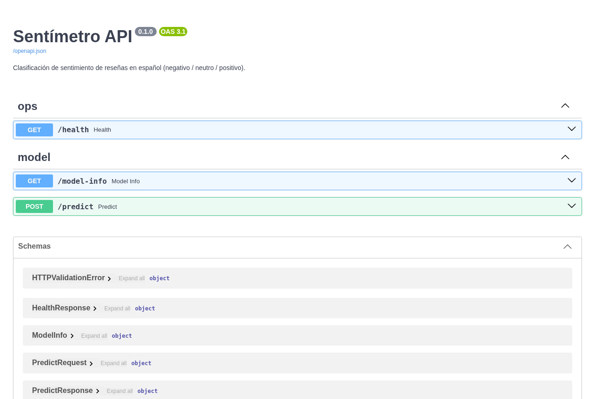

# Sentímetro · Pipeline de ML para análisis de sentimiento en español

[](https://github.com/acostamatias220/sentimetro/actions/workflows/ci.yml)


Pipeline **end-to-end** de machine learning que clasifica reseñas de productos en español como **negativas, neutras o positivas**: descarga reproducible de datos, limpieza y control de _leakage_, un **baseline clásico** (TF-IDF + regresión logística), **fine-tuning de un transformer en español** (DistilBETO) con PyTorch y 🤗 Transformers, seguimiento de experimentos con **MLflow**, exportación a **ONNX cuantizado (int8)** y una **API FastAPI** lista para producción con métricas de **Prometheus**, logs estructurados, Docker y CI.

> 🇬🇧 _End-to-end NLP pipeline for 3-class sentiment analysis of Spanish product reviews (Amazon reviews, ~200k): reproducible data prep with dedup and leakage control, TF-IDF + logistic regression baseline vs. fine-tuned DistilBETO (PyTorch + HF Trainer, class-weighted loss, early stopping), MLflow tracking, ONNX export with parity checks and int8 dynamic quantization, FastAPI batch inference service with Prometheus metrics, JSON logs, a web demo, Docker, pytest + ruff + mypy (strict) and GitHub Actions._



---

## ✨ Qué incluye

- **Datos reproducibles**: _dataset_ público de Hugging Face con **revisión fijada** (commit), limpieza de texto compartida entre entrenamiento y _serving_, deduplicación, descarte de textos ambiguos y **eliminación de solapamiento** entre train / validación / test.
- **Dos enfoques comparados con números reales**: baseline TF-IDF (palabras + n-gramas de caracteres) + regresión logística vs. **DistilBETO** (_fine-tuning_ completo con `Trainer`, _loss_ ponderada por clase, _early stopping_ y selección del mejor _checkpoint_ por macro-F1).
- **Configuración tipada**: un único `configs/params.yaml` validado con **pydantic**; cualquier valor se puede sobreescribir desde la CLI (`--set transformer.epochs=3`). Los mismos comandos corren el experimento chico en CPU o el entrenamiento completo en GPU.
- **Seguimiento de experimentos** con **MLflow** (parámetros, curvas de _loss_ y métricas por paso, artefactos, _tags_ con el commit de git).
- **Evaluación completa** sobre test: accuracy, **macro-F1**, F1 por clase, tasa de errores de polaridad, matriz de confusión, **análisis de errores** y _benchmark_ de latencia/throughput en CPU.
- **Producción**: exportación a **ONNX** con verificación de paridad contra PyTorch, **cuantización dinámica int8** (4× más chico) y una API **FastAPI** que no necesita PyTorch: `/predict` por lotes, `/health`, `/model-info`, `/metrics` (Prometheus) y una **demo web**.
- **Calidad**: 60 tests con pytest (la API se prueba con un **modelo dummy** entrenado en milisegundos y la exportación ONNX con un transformer diminuto creado localmente → CI sin descargas pesadas), **ruff**, **mypy --strict**, pre-commit con **gitleaks** y GitHub Actions.

## 🧱 Stack

| Capa            | Tecnologías                                                                                     |
| --------------- | ----------------------------------------------------------------------------------------------- |
| Datos           | 🤗 Datasets, pandas, pyarrow (Parquet)                                                           |
| Modelado        | scikit-learn (TF-IDF + LogisticRegression), PyTorch, 🤗 Transformers (`Trainer`), DistilBETO     |
| Experimentos    | MLflow (backend SQLite local + artefactos en disco), semillas fijas, config YAML + pydantic      |
| Inferencia      | ONNX, ONNX Runtime (int8 dinámico), 🤗 Tokenizers                                                |
| API             | FastAPI, pydantic v2, pydantic-settings, Uvicorn, prometheus-client                              |
| Calidad / DevOps | pytest, ruff, mypy (strict), pre-commit, gitleaks, uv, Docker multi-stage, docker compose, GitHub Actions |

## 🏗️ Arquitectura



### Flujo de una predicción



## 📊 Dataset

[`SetFit/amazon_reviews_multi_es`](https://huggingface.co/datasets/SetFit/amazon_reviews_multi_es): el subconjunto en español del _Multilingual Amazon Reviews Corpus_ (Keung et al., 2020), con 200.000 reseñas de train y 5.000 de validación y de test, balanceadas por estrellas. La descarga usa la revisión `1601541` para que siempre se obtengan exactamente los mismos datos.

Las 5 estrellas se agrupan en 3 clases:

| Estrellas | Clase      | Train (limpio) | Validación | Test  |
| --------- | ---------- | -------------: | ---------: | ----: |
| 1-2 ★     | `negativo` |         79.358 |      1.995 | 1.998 |
| 3 ★       | `neutro`   |         39.502 |        998 | 1.000 |
| 4-5 ★     | `positivo` |         78.248 |      1.985 | 1.992 |
| **Total** |            |    **197.108** |  **4.978** | **4.990** |

**Preprocesamiento** (`src/sentimetro/data/preprocess.py`):

1. Normalización liviana con `clean_text` (Unicode NFC, entidades y tags HTML, URLs/emails → _placeholders_, caracteres repetidos `buenoooo` → `buenooo`, espacios). Es **la misma función** que usa la API, para evitar _training/serving skew_.
2. Filtro por longitud (3 a 5.000 caracteres).
3. Deduplicación por texto normalizado; si un mismo texto aparece con etiquetas distintas se descarta (es ruido).
4. **Control de _leakage_**: se eliminan de train las reseñas que aparecen en validación o test, y de validación las que aparecen en test.

La mediana es de 22 palabras por reseña; con `max_length = 128` tokens solo se trunca ~1,7% de los textos.

> Los datos crudos y procesados **no se versionan** (`data/` está en `.gitignore`); se regeneran con `make data`.

## 🧠 Entrenamiento

### Baseline: TF-IDF + regresión logística

- Dos vectorizadores TF-IDF concatenados (`FeatureUnion`): **palabras** (1-2-gramas) y **caracteres** (2-5-gramas dentro de palabras, robustos a errores de tipeo, tildes faltantes y morfología), con `sublinear_tf` y `strip_accents`.
- `LogisticRegression` con `class_weight="balanced"`; `C` se elige en validación por **macro-F1**.
- Entrena con las ~197k reseñas en un par de minutos en CPU. Además se guardan los n-gramas más influyentes por clase en el _model card_ (interpretabilidad).

### Transformer: DistilBETO

- Modelo base [`dccuchile/distilbert-base-spanish-uncased`](https://huggingface.co/dccuchile/distilbert-base-spanish-uncased) (DistilBETO, 67M parámetros, versión destilada de BETO, preentrenado en español), con la revisión fijada.
- _Fine-tuning_ completo con `Trainer`: AdamW, _learning rate_ lineal con _warmup_ del 6%, _weight decay_ 0.01, **_padding_ dinámico** y **lotes agrupados por longitud** (mucho más rápido en CPU), evaluación periódica, **_early stopping_** y recuperación del mejor _checkpoint_ por macro-F1.
- **_Loss_ ponderada por clase** (inversa de la frecuencia): `neutro` es la clase minoritaria y la más difícil; ponderarla mejora el recall de esa clase y, con eso, el macro-F1.
- Semillas fijas (`random`, `numpy`, `torch`, `data_seed`) y _subsample_ estratificado determinista.

> **Restricción de cómputo (honestidad ante todo)**: los resultados de abajo se entrenaron en una **CPU de 8 núcleos sin GPU**. Por eso el transformer usa un _subsample_ estratificado de **100.000 reseñas** (~51% del train limpio), **1 época** y `max_length=128` (≈24 minutos). En GPU basta con `--set transformer.train_samples=null --set transformer.epochs=3 --set transformer.fp16=true`.

## 📈 Resultados

Evaluación sobre el **test completo (4.990 reseñas que el modelo nunca vio)**. Latencia y throughput medidos en la misma CPU de 8 núcleos (latencia = una reseña por request; throughput = lotes de 32).

| Modelo | Train | Accuracy | Macro-F1 | F1 neutro | Err. polaridad | Latencia p50 (1 texto) | Throughput (lotes de 32) | Tamaño |
| --- | ---: | ---: | ---: | ---: | ---: | ---: | ---: | ---: |
| TF-IDF + LogReg (30k) | 30k | 0.7214 | **0.6871** | 0.4738 | 4.09% | 1.5 ms | 3691 textos/s | 4 MB |
| TF-IDF + LogReg (completo) | 197k | 0.7413 | **0.7080** | 0.4939 | 2.63% | 1.2 ms | 3977 textos/s | 11 MB |
| DistilBETO (30k, 2 épocas, sin pesos de clase) | 30k | 0.7703 | **0.7085** | 0.4428 | 3.15% | 7.7 ms | 105 textos/s | 257 MB |
| DistilBETO (PyTorch) | 100k | 0.7589 | **0.7266** | 0.5129 | 1.46% | 10.0 ms | 78 textos/s | 257 MB |
| DistilBETO (ONNX fp32) | 100k | 0.7589 | **0.7266** | 0.5129 | 1.46% | 4.7 ms | 96 textos/s | 258 MB |
| DistilBETO (ONNX int8) | 100k | 0.7655 | **0.7347** | 0.5265 | 1.24% | 5.8 ms | 88 textos/s | 64 MB |

<sub>Train = reseñas usadas para entrenar. Err. polaridad = % de reseñas negativas clasificadas como positivas o viceversa (el error más grave para un negocio). Tamaño = pesos en disco. Benchmark de una sola corrida, orientativo.</sub>

**Lectura de los resultados**

- **Más datos ayudan al baseline, pero tiene techo**: pasar de 30k a 197k reseñas sube el macro-F1 de 0,687 a 0,708.
- **El transformer aprende mucho más por ejemplo**: con solo 30k reseñas, DistilBETO ya iguala al baseline entrenado con 6,5 veces más datos (0,7085 vs 0,7080).
- **Accuracy vs. macro-F1**: ese mismo modelo de 30k sin pesos de clase tiene la **mejor accuracy** (0,770) pero el **peor F1 en `neutro`** (0,443), porque "aprende" a evitar la clase minoritaria. Por eso el modelo se elige por macro-F1 y el modelo final usa _loss_ ponderada.
- **Modelo final (DistilBETO, 100k reseñas, _loss_ ponderada)**: macro-F1 **0,727** (+1,9 puntos sobre el mejor baseline), F1 `neutro` de 0,494 a 0,513 y **casi la mitad de errores de polaridad** (2,63% → 1,46%).
- **ONNX fp32** da **exactamente las mismas métricas** que PyTorch (diferencia máxima de probabilidad ≈ 1,5e-6) con **~2× menos latencia** (10,0 → 4,7 ms) y sin necesitar PyTorch en producción.
- **ONNX int8** es **4× más chico** (258 → 64 MB) y coincide con fp32 en el **97,6%** de las predicciones de validación (umbral mínimo del export: 97%). En test sacó incluso un poco más (0,735 vs 0,727), pero esa diferencia es ruido, no una mejora real. En esta CPU no fue más rápido que fp32 con textos cortos (la cuantización dinámica agrega trabajo por request); la ganancia es de **memoria, tamaño de imagen y arranque**. Es el modelo que se publica en `models/production`.
- El baseline sigue siendo **~4× más rápido** por texto y 40× en lotes: si la latencia o el costo importan más que 2-3 puntos de F1, es una opción válida.

Reportes completos por modelo (matriz de confusión, precisión/recall por clase y los errores en los que el modelo estaba más seguro) en [`reports/`](reports/), por ejemplo [`reports/distilbeto_onnx_int8`](reports/distilbeto_onnx_int8/README.md).

| TF-IDF + LogReg (completo) | DistilBETO ONNX int8 (producción) |
| --- | --- |
|  |  |

Casi todos los errores pasan **por `neutro`**: las confusiones directas negativo ↔ positivo son raras. El análisis de errores muestra tres patrones: **ruido de etiqueta** (texto claramente positivo con 2★), **opiniones mixtas** ("el producto es bueno pero el envío…") e **ironía**, que el modelo todavía no capta:



### Seguimiento en MLflow

Cada corrida registra la configuración completa, el commit de git, las curvas de _loss_ / macro-F1 por paso y los artefactos (`model_card.json`, reportes).



## 🚀 Cómo reproducirlo

### Requisitos

- Python 3.11-3.13 y [uv](https://docs.astral.sh/uv/) (o `pip`)
- ~3 GB libres (dataset, modelo base y _checkpoints_)
- GPU opcional (los valores por defecto están pensados para CPU)

### Pipeline completo

```bash
make install            # uv sync --all-extras (torch CPU) + hooks de pre-commit
cp .env.example .env    # opcional: HF_TOKEN solo sube el límite de descargas

make data               # descarga (revisión fijada) + limpieza → data/processed/
make train              # baselines + DistilBETO, todo registrado en MLflow
make export             # ONNX fp32 + int8 con chequeos de paridad → models/production/
make evaluate           # métricas, matrices, errores y benchmark → reports/
make serve              # API en http://127.0.0.1:8000 · demo en /demo/ · docs en /docs

make mlflow-ui          # experimentos en http://127.0.0.1:5000
```

`make pipeline` corre todo de punta a punta. Cada paso también existe como comando de la CLI (`uv run sentimetro --help`), y cualquier parámetro se puede cambiar sin tocar el código:

```bash
uv run sentimetro --set transformer.train_samples=null --set transformer.epochs=3 train-transformer
make train-transformer ARGS="--set transformer.learning_rate=3e-5"
make train-transformer-30k   # ablación de la tabla: 30k reseñas, 2 épocas, sin pesos de clase
```

Sin `make`/uv: `pip install -e ".[train]"` (para torch solo CPU agregar `--extra-index-url https://download.pytorch.org/whl/cpu`) y usar el comando `sentimetro`.

### Con Docker (solo inferencia)

```bash
make export                    # o copiar un modelo exportado a models/production/
cp .env.example .env
docker compose up --build      # API en :8000 y Prometheus en :9090
```

La imagen solo tiene FastAPI + ONNX Runtime (sin PyTorch), corre con usuario sin privilegios, sistema de archivos de solo lectura y _healthcheck_. El modelo se monta como volumen de solo lectura.

## 📡 API

| Método | Endpoint      | Descripción                                                                 |
| ------ | ------------- | --------------------------------------------------------------------------- |
| POST   | `/predict`    | Clasifica un lote de reseñas (hasta 64, cada una ≤ 5.000 caracteres)         |
| GET    | `/health`     | `200` si hay un modelo cargado, `503` si no (para _readiness probes_)         |
| GET    | `/model-info` | _Model card_: nombre, versión, backend, etiquetas, métricas de validación y test, límites |
| GET    | `/metrics`    | Métricas en formato Prometheus                                               |
| GET    | `/docs`       | OpenAPI / Swagger UI                                                         |
| GET    | `/demo/`      | Demo web                                                                     |

```bash
curl -s http://127.0.0.1:8000/predict \
  -H "Content-Type: application/json" \
  -d '{"texts": ["Llegó rapidísimo y funciona perfecto", "Se rompió a los dos días"]}'
```

```json
{
  "model": "sentimetro-distilbert-base-spanish-uncased-onnx-int8",
  "model_version": "0.1.0",
  "predictions": [
    {
      "label": "positivo",
      "score": 0.9494,
      "scores": {
        "negativo": 0.0038,
        "neutro": 0.0468,
        "positivo": 0.9494
      }
    },
    {
      "label": "negativo",
      "score": 0.6514,
      "scores": {
        "negativo": 0.6514,
        "neutro": 0.2754,
        "positivo": 0.0732
      }
    }
  ],
  "latency_ms": 8.59
}
```

La documentación interactiva (OpenAPI) se genera a partir de los schemas pydantic:



Errores: `422` si el cuerpo no es válido (lista vacía, textos vacíos, campos de más, lote o texto demasiado largos), `401` si se configuró `SENTIMETRO_API_KEY` y falta el header `X-API-Key`, `503` si no hay modelo cargado.

### Observabilidad

- **Logs JSON** de una línea por request con `request_id` (se respeta el header `X-Request-ID` entrante), ruta, estado, duración, tamaño del lote y tiempo de inferencia. **Nunca se loguea el texto de las reseñas** (pueden contener datos personales).
- **Prometheus**: requests por ruta/estado, latencia HTTP y de inferencia (histogramas), tamaño de lote, largo de los textos, **distribución de etiquetas predichas** y **de confianza**, y un _gauge_ con el modelo cargado. Un cambio en la proporción de `neutro` o una caída de la confianza media es una señal temprana de _data drift_ sin necesidad de etiquetas.

```text
sentimetro_http_requests_total{method="POST",route="/predict",status="200"} 3.0
sentimetro_inference_duration_seconds_count 3.0
sentimetro_inference_duration_seconds_sum 0.0414
sentimetro_predictions_total{label="positivo"} 4.0
sentimetro_predictions_total{label="neutro"} 3.0
sentimetro_predictions_total{label="negativo"} 2.0
sentimetro_prediction_confidence_count 9.0
sentimetro_model_info{backend="onnx",name="sentimetro-distilbert-base-spanish-uncased-onnx-int8",version="0.1.0"} 1.0
```

## 🧪 Tests y calidad

```bash
make test        # pytest + cobertura (incluye export ONNX de un transformer diminuto)
make test-fast   # sin los tests que necesitan torch
make lint        # ruff check + ruff format --check
make typecheck   # mypy --strict
```

| Archivo                   | Tests | Qué cubre                                                                                              |
| ------------------------- | ----: | ------------------------------------------------------------------------------------------------------ |
| `test_text.py`            | 9     | Limpieza de texto: HTML, URLs, emails, repeticiones, Unicode NFC, idempotencia                           |
| `test_preprocess.py`      | 7     | Mapeo de estrellas, deduplicación, textos ambiguos, **leakage**, muestreo estratificado determinista      |
| `test_metrics.py`         | 5     | Macro-F1 con valores conocidos, errores de polaridad, ranking de errores, gráfico                        |
| `test_config.py`          | 9     | YAML del proyecto, overrides tipados, valores inválidos rechazados                                      |
| `test_training.py`        | 3     | Pesos de clase, pipeline del baseline, entrenamiento completo con _model card_                           |
| `test_predictor.py`       | 4     | Softmax, orden de etiquetas, lotes y limpieza en inferencia                                             |
| `test_api.py`             | 19    | `/predict` por lotes, validaciones (422), límites, API key (401), sin modelo (503), request id, métricas Prometheus, **los logs no contienen el texto**, demo, OpenAPI |
| `test_onnx_export.py`     | 4     | Export ONNX de un DistilBERT diminuto: paridad con PyTorch, ejes dinámicos, int8 y la API sirviendo ONNX |

**60 tests** (cobertura 72%; la CLI y el loop de entrenamiento del transformer quedan fuera porque necesitan el modelo real).

CI (GitHub Actions) corre ruff, mypy y pytest con torch CPU, y construye la imagen Docker. Los _hooks_ de pre-commit agregan **gitleaks** y `detect-private-key` para que no se cuele ningún secreto.

## 📁 Estructura

```
sentimetro/
├── configs/params.yaml          # todos los parámetros del pipeline
├── src/sentimetro/
│   ├── config.py                # modelos pydantic + overrides --set a.b=c
│   ├── text.py                  # clean_text (compartida train/serving)
│   ├── data/                    # download.py · preprocess.py
│   ├── training/                # baseline.py · transformer.py
│   ├── evaluation/              # metrics · plots · benchmark · report
│   ├── export.py                # ONNX + int8 + paridad + publicación
│   ├── inference/predictor.py   # backends onnx / sklearn / transformers
│   ├── serving/                 # app FastAPI, schemas, settings, logging, métricas, web/
│   ├── tracking.py              # wrapper de MLflow
│   ├── model_card.py            # metadatos que viajan con cada modelo
│   └── cli.py                   # `sentimetro <comando>`
├── tests/                       # pytest (modelos dummy locales, sin descargas)
├── reports/                     # resultados versionados (métricas, matrices, errores)
├── deploy/prometheus.yml
├── Dockerfile · docker-compose.yml · Makefile
└── .github/workflows/ci.yml
```

## 🔐 Configuración y secretos

Todo se configura por `configs/params.yaml` (entrenamiento) y variables de entorno con prefijo `SENTIMETRO_` (API). El repositorio solo incluye [`.env.example`](.env.example) con valores vacíos; `.env`, los datos, los modelos y la base de MLflow están en `.gitignore`.

| Variable                       | Descripción                                               | Default             |
| ------------------------------ | --------------------------------------------------------- | ------------------- |
| `SENTIMETRO_MODEL_DIR`         | Carpeta del modelo a servir                               | `models/production` |
| `SENTIMETRO_API_KEY`           | Si se define, `/predict` exige `X-API-Key`                 | vacío (abierta)     |
| `SENTIMETRO_MAX_BATCH_SIZE`    | Máximo de textos por request                              | `64`                |
| `SENTIMETRO_MAX_TEXT_CHARS`    | Máximo de caracteres por texto                            | `5000`              |
| `SENTIMETRO_CORS_ORIGINS`      | Orígenes permitidos (lista JSON)                          | `[]`                |
| `SENTIMETRO_LOG_JSON` / `_LOG_LEVEL` | Formato y nivel de logs                             | `true` / `INFO`     |
| `SENTIMETRO_ORT_THREADS`       | Hilos de ONNX Runtime (0 = automático)                    | `0`                 |
| `HF_TOKEN`                     | Opcional, solo para más límite de descargas del Hub       | vacío               |

## ⚠️ Limitaciones

- **Cómputo**: el transformer se entrenó en CPU con la mitad del train y 1 época; con el dataset completo y más épocas en GPU el resultado debería mejorar.
- **Etiquetas derivadas de estrellas**: la etiqueta es la puntuación del usuario, no una anotación del texto. Hay ruido (reseñas positivas con 2★, quejas del envío con 3★) y el análisis de errores muestra que muchos "errores" con alta confianza son de este tipo.
- **`neutro` es intrínsecamente ambigua** (3★ mezcla opiniones tibias, mixtas y quejas leves): es la clase con peor F1 en todos los modelos.
- **Dominio y variedad del español**: reseñas de Amazon España; el rendimiento en otros dominios (restaurantes, redes sociales) o con voseo/modismos rioplatenses no está medido.
- Textos de más de 128 tokens se truncan (≈1,7% de las reseñas).
- Docker y docker compose están escritos pero **no se probaron** en la máquina de desarrollo (no tenía Docker); CI construye la imagen.

## 🗺️ Próximos pasos

- Entrenar con el dataset completo en GPU y probar modelos más grandes (BETO, RoBERTa-BNE, mDeBERTa) con búsqueda de hiperparámetros (Optuna + MLflow).
- Calibración de probabilidades (temperature scaling) y un umbral de "no sé" para predicciones de baja confianza.
- Detección de _drift_ en línea (distribución de embeddings / PSI) y dashboard de Grafana sobre las métricas de Prometheus.
- Registro de modelos de MLflow con etapas (_staging_ / _production_) y despliegue canary.
- Pipeline declarativo con DVC para cachear etapas y versionar datos.

## 📄 Licencia

MIT © Matías Acosta
