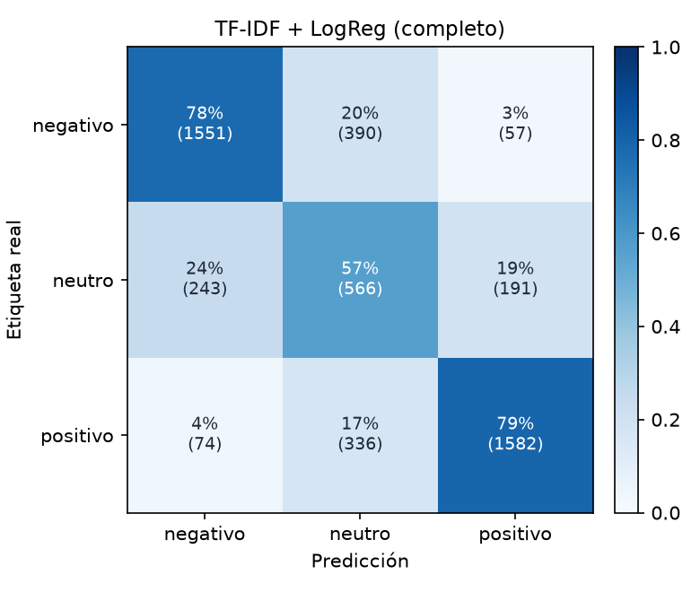

# TF-IDF + LogReg (completo)

Accuracy **0.7413** · macro-F1 **0.7080** · errores de polaridad (negativo ↔ positivo) **2.63%** sobre 4990 reseñas de test.

| Clase | Precisión | Recall | F1 | Soporte |
| --- | ---: | ---: | ---: | ---: |
| negativo | 0.830 | 0.776 | 0.802 | 1998 |
| neutro | 0.438 | 0.566 | 0.494 | 1000 |
| positivo | 0.864 | 0.794 | 0.828 | 1992 |
| **macro** | | | **0.708** | 4990 |

## Errores con mayor confianza

Los errores en los que el modelo estaba más seguro: suelen ser ruido de etiqueta (estrellas que no coinciden con el texto), opiniones mixtas o ironía.

| Estrellas | Real | Predicción | Confianza | Texto |
| :---: | --- | --- | ---: | --- |
| 3 | neutro | positivo | 1.00 | Me ha encantado, es súper comoda Mi bebe tiene 9 meses, y es perfecta para ella, y muy segura. Va contenta cuando la paseo. |
| 3 | neutro | positivo | 0.98 | Buen producto, buen material, rapidez en la entrega. RECOMENDADO. |
| 3 | neutro | negativo | 0.98 | Mala calidad, solo funciona la mitad, nada recomendable |
| 3 | neutro | negativo | 0.98 | Muy mala, se ve mal y no regula |
| 4 | positivo | neutro | 0.97 | La calidad plástico. No lleva cabes por eso le doy 3 estrellas. Haber q nos dice el electricista |
| 3 | neutro | positivo | 0.96 | Esta todo bien y me gusta mucho |
| 3 | neutro | positivo | 0.96 | Buen producto y buen precio |
| 3 | neutro | positivo | 0.95 | El tamaño es perfecto |
| 3 | neutro | positivo | 0.95 | Es un espejo sencillo, cumple su función para ver al bebé y es fácil de instalar. Contenta con la compra. |
| 3 | neutro | positivo | 0.95 | Perfecto para un perro de tamaño mediano como un beagle al mío le viene muy bien relación espacio y comodidad |
| 1 | negativo | neutro | 0.94 | Llegó en su tiempo. Por el precio no está mal pero me esperaba otra cosa. |
| 3 | neutro | negativo | 0.93 | En la pagina pone que se envian 2 pares y solo llega uno. |
