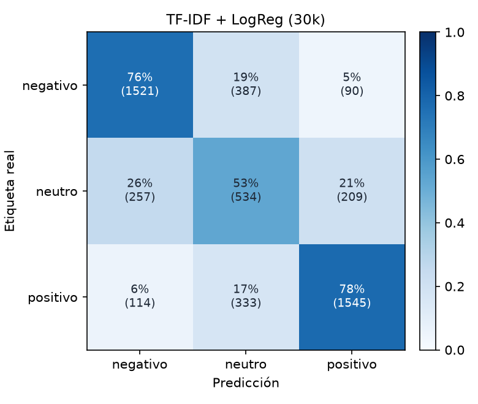

# TF-IDF + LogReg (30k)

Accuracy **0.7214** · macro-F1 **0.6871** · errores de polaridad (negativo ↔ positivo) **4.09%** sobre 4990 reseñas de test.

| Clase | Precisión | Recall | F1 | Soporte |
| --- | ---: | ---: | ---: | ---: |
| negativo | 0.804 | 0.761 | 0.782 | 1998 |
| neutro | 0.426 | 0.534 | 0.474 | 1000 |
| positivo | 0.838 | 0.776 | 0.806 | 1992 |
| **macro** | | | **0.687** | 4990 |

## Errores con mayor confianza

Los errores en los que el modelo estaba más seguro: suelen ser ruido de etiqueta (estrellas que no coinciden con el texto), opiniones mixtas o ironía.

| Estrellas | Real | Predicción | Confianza | Texto |
| :---: | --- | --- | ---: | --- |
| 3 | neutro | positivo | 0.98 | Me ha encantado, es súper comoda Mi bebe tiene 9 meses, y es perfecta para ella, y muy segura. Va contenta cuando la paseo. |
| 3 | neutro | positivo | 0.96 | Esta todo bien y me gusta mucho |
| 3 | neutro | negativo | 0.96 | Muy mala, se ve mal y no regula |
| 3 | neutro | positivo | 0.95 | Buen producto, buen material, rapidez en la entrega. RECOMENDADO. |
| 3 | neutro | positivo | 0.95 | Igual que el que venden en cualquier tienda, fácil instalación a buen precio. |
| 3 | neutro | negativo | 0.95 | Mala calidad, solo funciona la mitad, nada recomendable |
| 3 | neutro | positivo | 0.95 | Buen producto y buen precio |
| 3 | neutro | positivo | 0.94 | Es ligera y recomendable para niños |
| 3 | neutro | positivo | 0.94 | Muy buen producto y mejor diseño |
| 3 | neutro | negativo | 0.94 | Lo he devuelto porque solo funcionaba uno |
| 3 | neutro | positivo | 0.93 | Es un espejo sencillo, cumple su función para ver al bebé y es fácil de instalar. Contenta con la compra. |
| 3 | neutro | positivo | 0.92 | Perfecto para un perro de tamaño mediano como un beagle al mío le viene muy bien relación espacio y comodidad |
