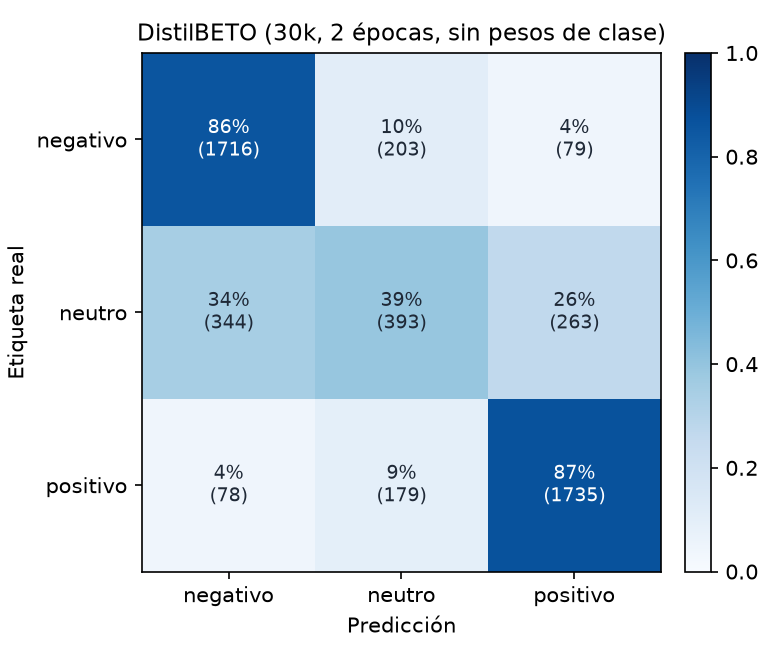

# DistilBETO (30k, 2 épocas, sin pesos de clase)

Accuracy **0.7703** · macro-F1 **0.7085** · errores de polaridad (negativo ↔ positivo) **3.15%** sobre 4990 reseñas de test.

| Clase | Precisión | Recall | F1 | Soporte |
| --- | ---: | ---: | ---: | ---: |
| negativo | 0.803 | 0.859 | 0.830 | 1998 |
| neutro | 0.507 | 0.393 | 0.443 | 1000 |
| positivo | 0.835 | 0.871 | 0.853 | 1992 |
| **macro** | | | **0.708** | 4990 |

## Errores con mayor confianza

Los errores en los que el modelo estaba más seguro: suelen ser ruido de etiqueta (estrellas que no coinciden con el texto), opiniones mixtas o ironía.

| Estrellas | Real | Predicción | Confianza | Texto |
| :---: | --- | --- | ---: | --- |
| 3 | neutro | negativo | 0.99 | Aun no me ha llegado el producto. A pesar del pago de envío urgente. Imposible ponerme en contacto con Seur ni con ustedes. Ruego solucionen el problema. Gracias. |
| 3 | neutro | positivo | 0.98 | El protector se observa de muy buena calidad y además es muy fácil de colocar en la pantalla. |
| 3 | neutro | negativo | 0.98 | Mala calidad, solo funciona la mitad, nada recomendable |
| 3 | neutro | negativo | 0.98 | Apenas alivia la sensación de picor. Conocía esta marca cuando estuve de viaje en Argentina y los insecticidas y repelentes eran realmente buenos, pero este producto no alivia la sensacion de picor de la picadura. No si… |
| 3 | neutro | positivo | 0.98 | Algo caras, pero te las dejan en tu casa y son super cómodos. Hemos probado ya muchas marcas y ésta es una de las que mejor nos ha ido a todos en la casa. Quizás más costosas que otras también buenas pero es una fácil s… |
| 3 | neutro | positivo | 0.98 | Me ha encantado, es súper comoda Mi bebe tiene 9 meses, y es perfecta para ella, y muy segura. Va contenta cuando la paseo. |
| 3 | neutro | positivo | 0.98 | Muy buenos auriculares y muy comodos, las almoadillas son finas y acolchadas y no molestan al dormir, el sonido tiene muy buena calidad, la diadema es un poco grande y se escapa con facilidad, puedes ajustar los altavoc… |
| 3 | neutro | positivo | 0.98 | Perfectos para el uso que le da el roomba |
| 3 | neutro | positivo | 0.98 | muy bueno, cómodo, se ajusta bien. q w e r t y u i o p a s d f |
| 3 | neutro | negativo | 0.98 | Son corrientes. Varios rotos, con agujero, y casi todos se desinchan al cabo de 2 horas. El brillo del anuncio no es real. Muy descontento con el producto. Asegura vendedor que incrementará su control de calidad. Efectú… |
| 3 | neutro | positivo | 0.98 | Muy buen producto y mejor diseño |
| 3 | neutro | negativo | 0.98 | El producto no llegó en el tiempo indicado, exactamente 24 días después, es lamentable que pasen estas cosas, ya no me sirve el producto para la fecha en la que ha llegado. |
