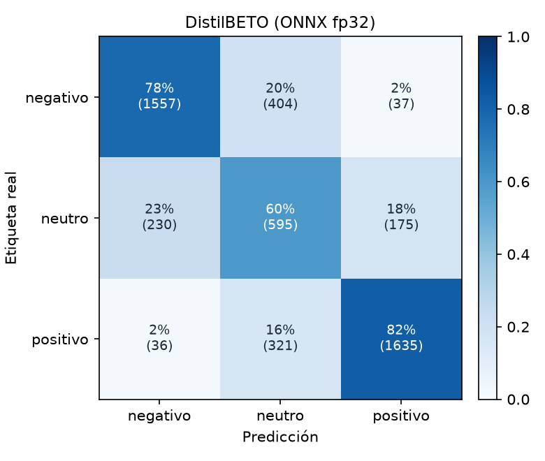

# DistilBETO (ONNX fp32)

Accuracy **0.7589** · macro-F1 **0.7266** · errores de polaridad (negativo ↔ positivo) **1.46%** sobre 4990 reseñas de test.

| Clase | Precisión | Recall | F1 | Soporte |
| --- | ---: | ---: | ---: | ---: |
| negativo | 0.854 | 0.779 | 0.815 | 1998 |
| neutro | 0.451 | 0.595 | 0.513 | 1000 |
| positivo | 0.885 | 0.821 | 0.852 | 1992 |
| **macro** | | | **0.727** | 4990 |

## Errores con mayor confianza

Los errores en los que el modelo estaba más seguro: suelen ser ruido de etiqueta (estrellas que no coinciden con el texto), opiniones mixtas o ironía.

| Estrellas | Real | Predicción | Confianza | Texto |
| :---: | --- | --- | ---: | --- |
| 3 | neutro | negativo | 0.97 | Mala calidad, solo funciona la mitad, nada recomendable |
| 3 | neutro | negativo | 0.96 | Muy mala, se ve mal y no regula |
| 3 | neutro | positivo | 0.96 | Buen producto, buen material, rapidez en la entrega. RECOMENDADO. |
| 3 | neutro | positivo | 0.96 | Me ha encantado, es súper comoda Mi bebe tiene 9 meses, y es perfecta para ella, y muy segura. Va contenta cuando la paseo. |
| 3 | neutro | positivo | 0.96 | El protector se observa de muy buena calidad y además es muy fácil de colocar en la pantalla. |
| 3 | neutro | positivo | 0.96 | Perfectos para el uso que le da el roomba |
| 3 | neutro | negativo | 0.96 | Son corrientes. Varios rotos, con agujero, y casi todos se desinchan al cabo de 2 horas. El brillo del anuncio no es real. Muy descontento con el producto. Asegura vendedor que incrementará su control de calidad. Efectú… |
| 3 | neutro | positivo | 0.95 | Muy buen producto y mejor diseño |
| 3 | neutro | negativo | 0.95 | Apenas alivia la sensación de picor. Conocía esta marca cuando estuve de viaje en Argentina y los insecticidas y repelentes eran realmente buenos, pero este producto no alivia la sensacion de picor de la picadura. No si… |
| 3 | neutro | positivo | 0.95 | PERFECTOS CUMPLEN CON SU COMETIDO SIN DIFICULTAD. |
| 3 | neutro | positivo | 0.95 | Es un espejo sencillo, cumple su función para ver al bebé y es fácil de instalar. Contenta con la compra. |
| 3 | neutro | positivo | 0.95 | Algo caras, pero te las dejan en tu casa y son super cómodos. Hemos probado ya muchas marcas y ésta es una de las que mejor nos ha ido a todos en la casa. Quizás más costosas que otras también buenas pero es una fácil s… |
