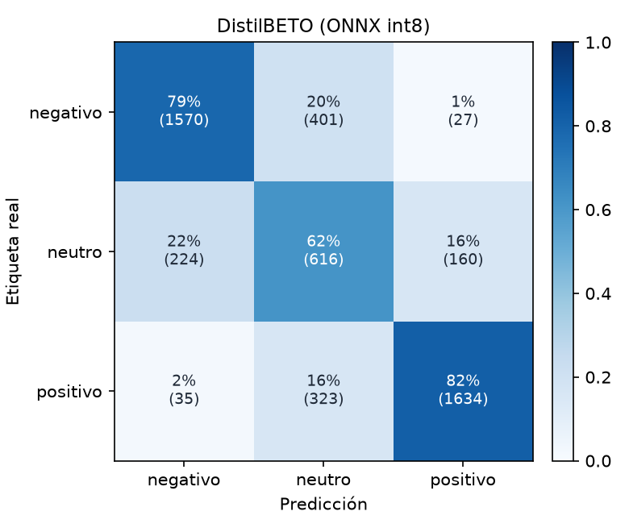

# DistilBETO (ONNX int8)

Accuracy **0.7655** · macro-F1 **0.7347** · errores de polaridad (negativo ↔ positivo) **1.24%** sobre 4990 reseñas de test.

| Clase | Precisión | Recall | F1 | Soporte |
| --- | ---: | ---: | ---: | ---: |
| negativo | 0.858 | 0.786 | 0.820 | 1998 |
| neutro | 0.460 | 0.616 | 0.526 | 1000 |
| positivo | 0.897 | 0.820 | 0.857 | 1992 |
| **macro** | | | **0.735** | 4990 |

## Errores con mayor confianza

Los errores en los que el modelo estaba más seguro: suelen ser ruido de etiqueta (estrellas que no coinciden con el texto), opiniones mixtas o ironía.

| Estrellas | Real | Predicción | Confianza | Texto |
| :---: | --- | --- | ---: | --- |
| 3 | neutro | negativo | 0.97 | Mala calidad, solo funciona la mitad, nada recomendable |
| 3 | neutro | positivo | 0.96 | Me ha encantado, es súper comoda Mi bebe tiene 9 meses, y es perfecta para ella, y muy segura. Va contenta cuando la paseo. |
| 3 | neutro | negativo | 0.96 | Muy mala, se ve mal y no regula |
| 3 | neutro | positivo | 0.96 | Perfectos para el uso que le da el roomba |
| 3 | neutro | positivo | 0.96 | El protector se observa de muy buena calidad y además es muy fácil de colocar en la pantalla. |
| 3 | neutro | negativo | 0.95 | Apenas alivia la sensación de picor. Conocía esta marca cuando estuve de viaje en Argentina y los insecticidas y repelentes eran realmente buenos, pero este producto no alivia la sensacion de picor de la picadura. No si… |
| 3 | neutro | negativo | 0.95 | a pesar de que se supone que es compatible con mi cámara se encasquilla a horrores!! ya no lo uso, la última vez me costó una barbaridad desenroscarla del objetivo . |
| 3 | neutro | positivo | 0.95 | Muy buen producto y mejor diseño |
| 3 | neutro | negativo | 0.95 | No me ha gustado...no es lo que esperaba. Se supone que en los videos y demostraciones que he visto del producto no se salía el líquido vertido y en cambio se junta con los demás agujeros y es un caos |
| 3 | neutro | positivo | 0.95 | Buen producto, buen material, rapidez en la entrega. RECOMENDADO. |
| 3 | neutro | negativo | 0.95 | Son corrientes. Varios rotos, con agujero, y casi todos se desinchan al cabo de 2 horas. El brillo del anuncio no es real. Muy descontento con el producto. Asegura vendedor que incrementará su control de calidad. Efectú… |
| 3 | neutro | positivo | 0.95 | Buenos materiales. Gran sonido. Sin problemas de conexión con ningún dispositivo Bluetooth que he probado. Los leds le dan un toque chic. |
